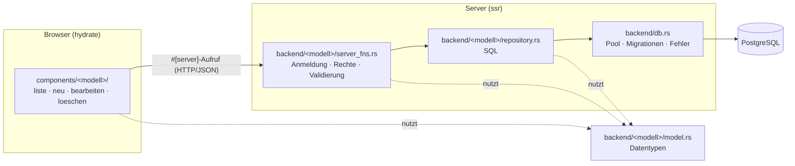
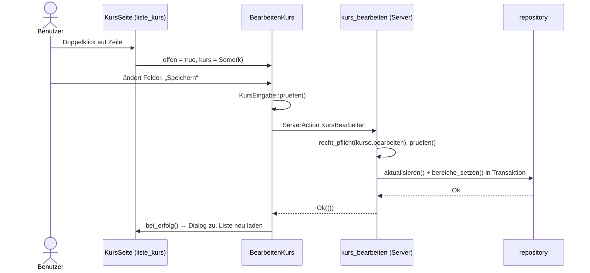

# System-Design

Ziel-Architektur für ERP-Stutz: Code wird **pro Modell** (Fachobjekt) organisiert, im Backend in
Schichten getrennt und im Frontend nach Benutzeraktionen (neu, bearbeiten, löschen) aufgeteilt.

Bezug: Datenmodell in [data-model.md](data-model.md), Roadmap in [../features/index.md](../features/index.md).

## 1. Überblick

ERP-Stutz ist eine Leptos-Anwendung (Rust) mit serverseitigem Rendering und Hydration:

| Teil | Technik | Build-Feature |
|---|---|---|
| Server | Axum, Leptos SSR, sqlx | `ssr` |
| Browser | Leptos als WebAssembly, Tailwind + DaisyUI | `hydrate` |
| Datenbank | PostgreSQL, Migrationen in `migrations/` | – |

Browser und Server teilen sich eine Crate. Der Browser ruft Server-Funktionen (`#[server]`) auf.
Leptos erzeugt dafür im Browser automatisch einen HTTP-Aufruf, auf dem Server läuft der echte Code.



## 2. Verzeichnisstruktur

```text
src/
├── main.rs                       Server-Start, Axum-Router
├── lib.rs                        Module, hydrate()
├── app.rs                        Routen, Layout, Sitzung (use_sitzung)
├── backend/
│   ├── mod.rs                    meldet alle Modelle an
│   ├── db.rs                     Pool, Migrationen, allgemeine Fehlerübersetzung   [ssr]
│   ├── gemeinsam.rs              Hilfen: pflicht(), zeitpunkt() …                  [ssr]
│   ├── auth/                     Anmeldung, Sitzung, recht_pflicht()               (Querschnitt)
│   └── <modell>/
│       ├── mod.rs                öffentliche Schnittstelle des Modells
│       ├── model.rs              Datentypen                                        [ssr + hydrate]
│       ├── server_fns.rs         #[server]-Funktionen                              [ssr + hydrate]
│       └── repository.rs         SQL-Zugriffe                                      [ssr]
└── components/
    ├── mod.rs
    ├── gemeinsam/                Dialog, ZeilenAktionen, Leer, Laden …
    └── <modell>/
        ├── mod.rs                öffentliche Komponenten des Modells
        ├── liste_<modell>.rs     Seite mit Tabelle (Route)
        ├── formular_<modell>.rs  Formularfelder, geteilt von neu und bearbeiten
        ├── neu_<modell>.rs       Dialog „Neu …“
        ├── bearbeiten_<modell>.rs Dialog „… bearbeiten“
        └── loeschen_<modell>.rs  Knopf mit Rückfrage „… löschen“
```

### Abweichungen von der Vorgabe und warum

| Vorgabe | Umsetzung | Grund |
|---|---|---|
| `pub.rs` | `mod.rs` | `pub` ist ein reserviertes Wort in Rust. Eine Datei `pub.rs` liesse sich nur als `mod r#pub;` einbinden. `mod.rs` erfüllt denselben Zweck: Es legt fest, was von aussen sichtbar ist. |
| `löschen_<name>` | `loeschen_<name>.rs` | Rust erlaubt keine Umlaute in Modulnamen ohne `#[path]` (Fehler E0754). Der Code schreibt ohnehin schon `loeschen`, `geschaeftsbereich`. |
| – | `liste_<modell>.rs` | **Ergänzt.** Irgendwo muss die Seite mit der Tabelle liegen, die die Dialoge öffnet. |
| – | `formular_<modell>.rs` | **Ergänzt.** Neu und Bearbeiten haben dieselben Felder. Ohne gemeinsame Datei würden sie doppelt gepflegt. |
| – | `components/<modell>/mod.rs` | **Ergänzt.** Rust braucht pro Verzeichnis ein `mod.rs`. |
| – | `backend/auth/`, `backend/gemeinsam.rs` | **Ergänzt.** Anmeldung und Hilfsfunktionen gehören keinem einzelnen Modell. |

Nebeneffekt: Die heutige Struktur `components/kurs/kurs.rs` verursacht 17 Clippy-Warnungen
(`module_inception`). Mit der neuen Struktur verschwinden sie (vgl. T-006 in `task.md`).

## 3. Modelle

Ein Modell entspricht einer Tabelle aus [data-model.md](data-model.md). M:N-Tabellen
(`kurs_geschaeftsbereich`, `termin_mitarbeiter` …) haben kein eigenes Modell: Sie gehören zum
Modell, das sie bearbeitet.

| Modell (Verzeichnis) | Tabellen | Bereich (Rechte) | heute in |
|---|---|---|---|
| `adresse` | `adresse` | `Adressen` | `backend/api.rs`, `components/adresse/` |
| `geschaeftsbereich` | `geschaeftsbereich` | `Geschaeftsbereiche` | `backend/api.rs`, `components/geschaeftsbereich/` |
| `kurs` | `kurs`, `kurs_geschaeftsbereich` | `Kurse` | `backend/api.rs`, `components/kurs/` |
| `termin` | `termin`, `termin_geschaeftsbereich`, `termin_mitarbeiter` | `Termine`, `Anmeldung` | `backend/api.rs`, `backend/pdf.rs`, `components/termin/`, `components/termin_anmeldung/` |
| `mitarbeiter` | `mitarbeiter` | `Mitarbeiter` | `backend/api.rs`, `components/mitarbeiter/` |
| `bauobjekt` | `bauobjekt` | `Bauobjekte` | `backend/projekte.rs`, `components/projekt/` |
| `projekt` | `projekt` | `Projekte` | `backend/projekte.rs`, `components/projekt/` |
| `buchung` | `buchung` | `Buchungen`, `Stunden` | `backend/projekte.rs`, `components/buchung/` |
| `benutzer` | `benutzer` | `Benutzer` | `backend/auth.rs`, `components/benutzer/` |
| `rolle` | `rolle` | `Rollen` | `backend/rollen.rs`, `components/rolle/` |
| `auth` (Querschnitt) | `sitzung` | – | `backend/auth.rs`, `backend/microsoft.rs` |

`Bereich`, `Aktion` und die Rechte-Logik kommen nach `backend/rolle/model.rs`.
Seiten ohne eigenes Modell (`layout`, `einstellungen`, `weiterbildung`, `modul`, `kein_zugriff`,
`anmeldung` als Login-Seite) bleiben unter `components/`, aber flach als `components/<name>/mod.rs`.

## 4. Backend

### 4.1 Schichten und Regeln

```text
components  →  server_fns  →  repository  →  db
                    ↘               ↘
                        model.rs (von allen genutzt)
```

| Datei | Aufgabe | Darf | Darf nicht |
|---|---|---|---|
| `model.rs` | Datentypen für Lesen (`Kurs`) und Schreiben (`KursEingabe`), reine Logik ohne Ein-/Ausgabe | `serde`, `chrono`, `uuid`; `sqlx::FromRow` nur über `cfg_attr(feature = "ssr")` | Datenbank, HTTP, Leptos-Komponenten |
| `server_fns.rs` | Einstiegspunkt aus dem Browser: Anmeldung und Recht prüfen, Eingaben prüfen, Transaktion steuern, Repository aufrufen | `auth`, `gemeinsam`, `repository` (im `ssr`-Teil) | SQL schreiben |
| `repository.rs` | Nur SQL: lesen, einfügen, ändern, löschen. Eine Funktion = eine fachliche Abfrage | `sqlx`, `db` | Rechte prüfen, Eingaben prüfen, `ServerFnError` erzeugen |
| `mod.rs` | Öffentliche Schnittstelle | `pub use` von Typen und Server-Funktionen | Logik |
| `db.rs` | Pool, `sqlx::migrate!`, allgemeine Fehlerübersetzung | | modellspezifische Meldungen (gehören ins Modell, siehe 4.6) |

Wichtigste Regel: **Komponenten importieren nur aus `backend::<modell>` (also `mod.rs`)**,
nie direkt aus `repository`.

### 4.2 Feature-Flags

Der Browser-Build kennt kein `sqlx`. Deshalb:

| Datei | Kompiliert für | Einbindung in `mod.rs` |
|---|---|---|
| `model.rs` | Server und Browser | `mod model;` |
| `server_fns.rs` | Server und Browser (Leptos erzeugt im Browser nur den Aufruf) | `mod server_fns;` |
| `repository.rs` | nur Server | `#[cfg(feature = "ssr")] mod repository;` |
| `db.rs`, `gemeinsam.rs` | nur Server | `#[cfg(feature = "ssr")] pub mod db;` |

Innerhalb von `server_fns.rs` sind `use`-Anweisungen für `repository`, `db` und `auth`-Helfer
ebenfalls mit `#[cfg(feature = "ssr")]` geschützt.

### 4.3 Namenskonventionen

| Was | Muster | Beispiel Kurs |
|---|---|---|
| Lesetyp | `<Modell>` | `Kurs` |
| Schreibtyp | `<Modell>Eingabe` | `KursEingabe` |
| Server-Funktion Liste | `<modelle>_laden` | `kurse_laden` |
| Server-Funktion einzeln | `<modell>_laden` | `kurs_laden` |
| Server-Funktion neu | `<modell>_anlegen` | `kurs_anlegen` → Recht `kurse.anlegen` |
| Server-Funktion ändern | `<modell>_bearbeiten` | `kurs_bearbeiten` → Recht `kurse.bearbeiten` |
| Server-Funktion löschen | `<modell>_loeschen` | `kurs_loeschen` → Recht `kurse.loeschen` |
| Repository | Verb ohne Modellname | `repository::alle`, `finden`, `einfuegen`, `aktualisieren`, `loeschen` |
| Komponenten | `<Modell>Seite`, `Neu<Modell>`, `Bearbeiten<Modell>`, `Loeschen<Modell>`, `<Modell>Formular` | `KursSeite`, `NeuKurs`, `BearbeitenKurs`, `LoeschenKurs`, `KursFormular` |

Die Server-Funktionen heissen wie die Aktionen in `Aktion` (`Anlegen`, `Bearbeiten`, `Loeschen`).
Das heutige `kurs_speichern(id: Option<Uuid>, …)` wird in `kurs_anlegen` und `kurs_bearbeiten`
aufgeteilt. So hat jede Funktion genau ein Recht, und die Komponenten `neu_` und `bearbeiten_`
haben je ihre eigene Server-Funktion.

### 4.4 Beispiel: `backend/kurs/`

`mod.rs`

```rust
//! Kurse: Stammdaten der angebotenen Weiterbildungen.

mod model;
mod server_fns;
#[cfg(feature = "ssr")]
mod repository;

pub use model::*;
pub use server_fns::*;
```

`model.rs`

```rust
use serde::{Deserialize, Serialize};
use uuid::Uuid;

#[derive(Clone, Debug, PartialEq, Serialize, Deserialize)]
#[cfg_attr(feature = "ssr", derive(sqlx::FromRow))]
pub struct Kurs {
    pub id: Uuid,
    pub titel: String,
    pub beschreibung: String,
    pub dauer_stunden: i32,
    /// Zugeordnete Geschäftsbereiche (M:N)
    pub geschaeftsbereich_ids: Vec<Uuid>,
}

/// Eingaben aus dem Formular „Neuer Kurs“ bzw. „Kurs bearbeiten“.
#[derive(Clone, Debug, Default, PartialEq, Serialize, Deserialize)]
pub struct KursEingabe {
    pub titel: String,
    pub beschreibung: String,
    pub dauer_stunden: i32,
    pub geschaeftsbereich_ids: Vec<Uuid>,
}

impl KursEingabe {
    /// Fachliche Prüfung; läuft im Browser (sofortige Meldung) und auf dem Server.
    pub fn pruefen(&self) -> Result<(), String> {
        if self.titel.trim().is_empty() {
            return Err("Titel darf nicht leer sein.".into());
        }
        if self.dauer_stunden < 0 {
            return Err("Die Dauer darf nicht negativ sein.".into());
        }
        Ok(())
    }
}
```

`server_fns.rs`

```rust
//! Server-Funktionen für Kurse: werden im Browser aufgerufen und laufen auf dem Server.

use leptos::prelude::*;
use leptos::server_fn::codec::Json;
use uuid::Uuid;

use super::model::{Kurs, KursEingabe};
#[cfg(feature = "ssr")]
use {
    super::repository,
    crate::backend::auth::server::recht_pflicht,
    crate::backend::db::pool,
    crate::backend::rolle::{Aktion, Bereich},
};

#[server(input = Json)]
pub async fn kurse_laden() -> Result<Vec<Kurs>, ServerFnError> {
    recht_pflicht(&[(Bereich::Kurse, Aktion::Sehen), (Bereich::Termine, Aktion::Sehen)]).await?;
    repository::alle(pool()).await.map_err(super::fehler)
}

#[server(input = Json)]
pub async fn kurs_anlegen(eingabe: KursEingabe) -> Result<Uuid, ServerFnError> {
    recht_pflicht(&[(Bereich::Kurse, Aktion::Anlegen)]).await?;
    eingabe.pruefen().map_err(ServerFnError::new)?;
    let mut tx = pool().begin().await.map_err(super::fehler)?;
    let id = repository::einfuegen(&mut tx, &eingabe).await.map_err(super::fehler)?;
    repository::bereiche_setzen(&mut tx, id, &eingabe.geschaeftsbereich_ids).await.map_err(super::fehler)?;
    tx.commit().await.map_err(super::fehler)?;
    Ok(id)
}

#[server(input = Json)]
pub async fn kurs_bearbeiten(id: Uuid, eingabe: KursEingabe) -> Result<(), ServerFnError> {
    recht_pflicht(&[(Bereich::Kurse, Aktion::Bearbeiten)]).await?;
    // wie kurs_anlegen, mit repository::aktualisieren
    todo!()
}

#[server(input = Json)]
pub async fn kurs_loeschen(id: Uuid) -> Result<(), ServerFnError> {
    recht_pflicht(&[(Bereich::Kurse, Aktion::Loeschen)]).await?;
    repository::loeschen(pool(), id).await.map_err(super::fehler)
}
```

`repository.rs`

```rust
//! SQL-Zugriffe für Kurse (nur Server).

use sqlx::{PgConnection, PgPool};
use uuid::Uuid;

use super::model::{Kurs, KursEingabe};

pub async fn alle(pool: &PgPool) -> sqlx::Result<Vec<Kurs>> {
    sqlx::query_as(
        "SELECT k.id, k.titel, k.beschreibung, k.dauer_stunden,
                COALESCE(array_agg(kg.geschaeftsbereich_id)
                         FILTER (WHERE kg.geschaeftsbereich_id IS NOT NULL), '{}') AS geschaeftsbereich_ids
         FROM kurs k LEFT JOIN kurs_geschaeftsbereich kg ON kg.kurs_id = k.id
         GROUP BY k.id
         ORDER BY k.titel",
    )
    .fetch_all(pool)
    .await
}

pub async fn einfuegen(tx: &mut PgConnection, e: &KursEingabe) -> sqlx::Result<Uuid> {
    sqlx::query_scalar(
        "INSERT INTO kurs (titel, beschreibung, dauer_stunden) VALUES ($1, $2, $3) RETURNING id",
    )
    .bind(e.titel.trim())
    .bind(e.beschreibung.trim())
    .bind(e.dauer_stunden)
    .fetch_one(tx)
    .await
}

pub async fn loeschen(pool: &PgPool, id: Uuid) -> sqlx::Result<()> {
    sqlx::query("DELETE FROM kurs WHERE id = $1").bind(id).execute(pool).await?;
    Ok(())
}

// aktualisieren(), bereiche_setzen() analog
```

### 4.5 Transaktionen

- Lesende Funktionen und Einzelbefehle nehmen `&PgPool`.
- Funktionen, die Teil einer Transaktion sein können, nehmen `&mut PgConnection`
  (eine `sqlx::Transaction` lässt sich mit `&mut tx` übergeben).
- **Die Server-Funktion** öffnet und bestätigt die Transaktion, nicht das Repository.
  So können mehrere Repository-Aufrufe (Kurs + Geschäftsbereiche) zusammen gelingen oder scheitern.

### 4.6 Fehlerbehandlung

| Schicht | Fehlertyp | Verantwortung |
|---|---|---|
| `repository.rs` | `sqlx::Result<T>` | gibt Datenbankfehler unverändert weiter |
| `<modell>/mod.rs` | `fn fehler(e: sqlx::Error) -> ServerFnError` | übersetzt die **eigenen** Constraints (z. B. `termin_kurs_id_fkey` → „Der Kurs kann nicht gelöscht werden, solange noch Termine existieren.“), sonst Aufruf von `db::fehler` |
| `db.rs` | `db::fehler` | allgemeine Fälle (CHECK verletzt, unbekannter Fehler → Server-Log und neutrale Meldung) |
| `server_fns.rs` | `ServerFnError` | Rechte- und Validierungsfehler mit verständlichem deutschem Text |
| Komponenten | `meldung_aus(e)` | zeigen den Text in `Fehlermeldung` an |

Damit wandert die lange Liste in `db::fehler` Stück für Stück in die Modelle.

### 4.7 Querschnitt

| Modul | Inhalt |
|---|---|
| `backend/auth/` | `server_fns.rs` (anmelden, registrieren, abmelden, aktueller Benutzer), `sitzung.rs` (Cookie, Token-Hash), `rechte.rs` (`benutzer_pflicht`, `recht_pflicht`), `microsoft.rs` (OAuth) |
| `backend/gemeinsam.rs` | `pflicht()`, `zeitpunkt()` und weitere Prüfhelfer |
| `backend/termin/pdf.rs` | Teilnehmerliste als PDF (Axum-Route in `main.rs`); gehört fachlich zum Termin |

Jede Server-Funktion beginnt mit `recht_pflicht(…)`. Das UI blendet Knöpfe ohne Recht aus,
schützt aber nichts: **die Prüfung auf dem Server ist massgebend.**

## 5. Frontend

### 5.1 Komponenten pro Modell

| Datei | Komponente | Inhalt | Server-Funktion | Recht |
|---|---|---|---|---|
| `liste_<modell>.rs` | `<Modell>Seite` | Seitenkopf, Tabelle, Zustände (laden, leer, Fehler), öffnet die Dialoge | `<modelle>_laden` | `sehen` |
| `formular_<modell>.rs` | `<Modell>Formular` | Formularfelder; bekommt Signale, kennt keine Server-Funktion | – | – |
| `neu_<modell>.rs` | `Neu<Modell>` | Knopf „Neu …“ im Seitenkopf + Dialog mit leerem Formular | `<modell>_anlegen` | `anlegen` |
| `bearbeiten_<modell>.rs` | `Bearbeiten<Modell>` | Dialog mit vorbefülltem Formular | `<modell>_bearbeiten` | `bearbeiten` |
| `loeschen_<modell>.rs` | `Loeschen<Modell>` | Icon-Knopf in der Zeile, Rückfrage mit `bestaetigt(…)` | `<modell>_loeschen` | `loeschen` |
| `mod.rs` | – | `pub use liste_<modell>::<Modell>Seite;` und was andere Modelle brauchen | – | – |

Wiederverwendbare Bausteine bleiben in `components/gemeinsam/` (`Dialog`, `DialogAktionen`,
`ZeilenAktionen`, `Seitenkopf`, `Leer`, `Laden`, `Fehlermeldung`, `ergebnis_beobachten`).

### 5.2 Zusammenspiel



Regeln:

- **Die Seite besitzt den Zustand der Liste** (`Resource`) und ein Signal `aktualisiert: RwSignal<u32>`.
  Die Resource hängt von diesem Signal ab.
- **Jeder Dialog besitzt seine eigene `ServerAction`** und meldet Erfolg über
  `bei_erfolg: Callback<()>`. Die Seite erhöht dann `aktualisiert` und lädt neu.
- `BearbeitenKurs` bekommt das zu bearbeitende Objekt über `RwSignal<Option<Kurs>>`:
  `Some` öffnet den Dialog, `None` schliesst ihn.
- `NeuKurs` und `BearbeitenKurs` nutzen beide `KursFormular`. Unterschiede (Titel, Startwerte,
  Server-Funktion) liegen nur in den beiden Dialog-Dateien.
- Rechte werden mit `use_sitzung().recht(Bereich::…, Aktion::…)` geprüft: ohne Recht wird der Knopf
  bzw. Dialog nicht angezeigt.
- Fehler aus dem Dialog erscheinen im Dialog, Fehler beim Löschen über der Tabelle.

### 5.3 Beispiel: `components/kurs/`

```rust
// mod.rs
mod bearbeiten_kurs;
mod formular_kurs;
mod liste_kurs;
mod loeschen_kurs;
mod neu_kurs;

pub use liste_kurs::KursSeite;
pub(crate) use formular_kurs::BereichAuswahl; // wird auch vom Termin genutzt
```

```rust
// liste_kurs.rs (Auszug)
#[component]
pub fn KursSeite() -> impl IntoView {
    let aktualisiert = RwSignal::new(0u32);
    let neu_laden = Callback::new(move |_| aktualisiert.update(|n| *n += 1));
    let kurse = Resource::new(move || aktualisiert.get(), |_| kurse_laden());
    let bearbeite = RwSignal::new(None::<Kurs>);

    view! {
        <Seitenkopf titel="Kurse" untertitel="Angebotene Kurse verwalten">
            <NeuKurs bei_erfolg=neu_laden/>
        </Seitenkopf>
        // Tabelle: Doppelklick → bearbeite.set(Some(k)); in jeder Zeile <LoeschenKurs id bei_erfolg=neu_laden/>
        <BearbeitenKurs kurs=bearbeite bei_erfolg=neu_laden/>
    }
}
```

## 6. Neues Modell anlegen (Checkliste)

1. Spezifikation nach [`features/_vorlage.md`](../features/_vorlage.md) (Skill `feature-spec`).
2. Migration (Skill `migration`), `docs/data-model.md` nachführen.
3. `backend/<modell>/` mit `mod.rs`, `model.rs`, `repository.rs`, `server_fns.rs`; in `backend/mod.rs` eintragen.
4. Falls neuer Bereich: `Bereich` in `backend/rolle/model.rs` ergänzen, Rechte für bestehende Rollen per Migration.
5. `components/<modell>/` mit `mod.rs`, `liste_`, `formular_`, `neu_`, `bearbeiten_`, `loeschen_`; in `components/mod.rs` eintragen.
6. Route mit `Bereichsschutz` in `app.rs`, Menüeintrag in `components/layout`.
7. Tests (Skill `test`): `model.rs` (Validierung), `repository.rs` mit `#[sqlx::test]`, Rechte (Admin / mit Recht / ohne Recht).
8. Skill `build` für Server **und** Browser (der Browser-Build findet vergessene `cfg(feature = "ssr")`).

## 7. Umstellung des bestehenden Codes

Schrittweise, **ein Modell pro Pull Request**, damit die App nach jedem Schritt läuft.
Bis alles umgestellt ist, dürfen `backend/api.rs` und `models.rs` noch Teile enthalten.

| Schritt | Modell | Warum in dieser Reihenfolge |
|---|---|---|
| 1 | `backend/db.rs`, `backend/gemeinsam.rs`, `backend/rolle/model.rs` (`Bereich`, `Aktion`) | Grundlage für alle anderen |
| 2 | `geschaeftsbereich` | kleinstes Modell, zeigt das Muster |
| 3 | `adresse` | einfach, wird von vielen genutzt |
| 4 | `kurs` | erstes Modell mit M:N |
| 5 | `mitarbeiter` | |
| 6 | `bauobjekt`, `projekt`, `buchung` | aus `backend/projekte.rs` |
| 7 | `termin` (inkl. Teilnehmende, PDF) | grösstes Modell (`termin.rs` ~950 Zeilen) |
| 8 | `rolle`, `benutzer`, `auth` | Anmeldung zuletzt, höchstes Risiko |
| 9 | `backend/api.rs`, `backend/projekte.rs`, `models.rs` löschen | wenn leer |

Pro Schritt: Verhalten unverändert lassen (reine Umstrukturierung), Skills `build` und `test` grün,
im Browser einmal anlegen, bearbeiten und löschen.

## 8. Entscheidungen

| # | Entscheidung | Begründung |
|---|---|---|
| 1 | Struktur pro Modell statt pro Schicht (`api.rs`, `models.rs`) | Alles zu einem Fachobjekt liegt beieinander. Neue ERP-Module (Einkauf, Lager …) kommen als neue Verzeichnisse dazu, ohne grosse Sammeldateien. |
| 2 | Repository getrennt von Server-Funktionen | SQL ist ohne Anmeldung und HTTP testbar (`#[sqlx::test]`), Rechte und Validierung liegen an einer Stelle. |
| 3 | `anlegen` und `bearbeiten` als getrennte Server-Funktionen | Ein Recht pro Funktion, passt zu den Komponenten `neu_` und `bearbeiten_`. |
| 4 | SQL zur Laufzeit (`sqlx::query`) statt `query!`-Makros | Build ohne Datenbank möglich (lokal, Docker, CI). Fehler im SQL fangen die Datenbank-Tests. |
| 5 | Validierung in `model.rs` | Läuft im Browser für schnelle Meldungen und auf dem Server zur Sicherheit, mit demselben Code. |
