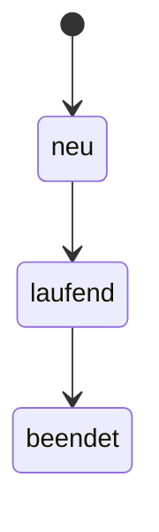

# F-XXX: <Feature-Name>

> **Vorlage (Goldstandard).** Kopieren nach `features/F-XXX-<kurzname>.md`, Platzhalter `<…>` ersetzen.
> Abschnitte, die nicht zutreffen, nicht löschen, sondern mit „Entfällt, weil …“ begründen.
> So ist sichtbar, dass sie bedacht wurden.

| Feld | Wert |
|---|---|
| ID | F-XXX |
| Status | Entwurf · Bereit · In Arbeit · Im Test · Erledigt · Verworfen |
| Priorität | Muss · Soll · Kann |
| Bereich (ERP) | <z. B. Personal › Weiterbildung, Projekte, Einkauf> |
| Verantwortlich | <Name> |
| Erstellt / geändert | <JJJJ-MM-TT> / <JJJJ-MM-TT> |
| Abhängig von | <F-YYY, Migration, externe Systeme> |
| Roadmap | [features/index.md](index.md) |

---

## 1. Ziel und Nutzen

- **Problem:** Was funktioniert heute nicht oder fehlt?
- **Ziel:** Was ist nach dem Feature anders? (ein bis zwei Sätze)
- **Nutzen:** Für wen, wie messbar? (z. B. „Erfassung pro Termin < 1 Minute“)

## 2. Abgrenzung

| Im Umfang | Nicht im Umfang |
|---|---|
| <…> | <… bewusst später oder nie> |

## 3. Begriffe

| Begriff | Bedeutung im Projekt |
|---|---|
| <Begriff> | <Definition; deckungsgleich mit Tabellen- und Spaltennamen> |

## 4. Rollen und Berechtigungen

Rechte haben das Format `<bereich>.<aktion>` (siehe `Bereich` und `Aktion` in `src/models.rs`).
Admin-Rollen (`rolle.ist_admin`) haben immer alle Rechte.

| Recht | Wer braucht es | Was ist damit erlaubt |
|---|---|---|
| `<bereich>.sehen` | <Rolle> | <…> |
| `<bereich>.anlegen` | | |
| `<bereich>.bearbeiten` | | |
| `<bereich>.loeschen` | | |

- Neuer `Bereich` nötig? ja/nein · Migration für bestehende Rollen nötig? ja/nein (welche Rollen bekommen das Recht?)
- Was sieht ein Benutzer **ohne** Recht? (Menüpunkt ausgeblendet, „Kein Zugriff“, Knopf deaktiviert)
- Serverseitige Prüfung in jeder Server-Funktion (nicht nur im UI)

## 5. User Stories

| ID | Als … | möchte ich … | damit … | Priorität |
|---|---|---|---|---|
| US-1 | <Rolle> | <Handlung> | <Nutzen> | Muss |

## 6. Fachliche Anforderungen

### 6.1 Funktionale Anforderungen

| ID | Anforderung | Story |
|---|---|---|
| FA-1 | Das System muss … | US-1 |

### 6.2 Geschäftsregeln und Validierung

| ID | Regel | Wo geprüft (DB / Server / UI) | Meldung an den Benutzer |
|---|---|---|---|
| GR-1 | <z. B. Ende liegt nach Beginn> | DB (CHECK) + UI | „Das Ende muss nach dem Beginn liegen.“ |

### 6.3 Status und Abläufe

Falls das Objekt einen Lebenszyklus hat (vgl. `termin_status`):

| Von | Nach | Auslöser | Wer darf | Bedingung |
|---|---|---|---|---|
| neu | laufend | <…> | <Recht> | <…> |



## 7. Datenmodell

Bezug: [docs/data-model.md](../docs/data-model.md). Nach der Umsetzung dort nachführen.

### 7.1 Neue oder geänderte Tabellen

| Tabelle | Spalte | Datentyp | Null | Standard | Schlüssel / Bedingung | Bemerkung |
|---|---|---|---|---|---|---|
| `<tabelle>` | `id` | `UUID` | nein | `gen_random_uuid()` | PK | |

### 7.2 Beziehungen

| Von | Nach | Kardinalität | `ON DELETE` | Begründung |
|---|---|---|---|---|
| `<tabelle>.<fk>_id` | `<ziel>.id` | N:1 | RESTRICT · SET NULL · CASCADE | <warum dieses Verhalten> |

### 7.3 Migration

- Datei: `migrations/<JJJJMMTT>000001_<name>.sql` (fortlaufend, bestehende Migrationen nie ändern)
- Umgang mit **bestehenden Daten** (Übernahme, Standardwerte, Bereinigung)
- Indizes auf alle Fremdschlüssel
- Rechte für bestehende Rollen ergänzen (`UPDATE rolle SET rechte = …`)

## 8. Benutzeroberfläche

### 8.1 Navigation und Route

| Route | Komponente | Menü | Schutz |
|---|---|---|---|
| `/<pfad>` | `src/components/<modul>/<modul>.rs` | <Gruppe › Eintrag> | `Bereichsschutz bereich=Bereich::<…>` |

### 8.2 Ansichten

Für jede Ansicht (Liste, Detail, Formular, Dialog):

- **Zweck und Inhalt:** Spalten, Felder, Reihenfolge, Sortierung, Filter, Suche
- **Aktionen:** Knöpfe mit nötigem Recht
- **Zustände:** Laden · leer (`Leer`-Komponente, Text) · Fehler · ohne Recht
- **Skizze / Screenshot:** <Link oder ASCII>

### 8.3 Formularfelder

| Feld | Typ / Eingabe | Pflicht | Standard | Validierung | Hilfetext |
|---|---|---|---|---|---|
| <Feld> | Text · Zahl · Datum · Auswahl | ja | | <GR-x> | |

### 8.4 Gestaltung und Bedienbarkeit

- DaisyUI-Komponenten und bestehende gemeinsame Bausteine (`src/components/gemeinsam`) wiederverwenden
- Kompakte Tabellen-Einstellung (Zeilengrösse) berücksichtigen
- Mobil / schmale Bildschirme · Tastaturbedienung · verständliche Texte auf Deutsch

## 9. Schnittstellen

### 9.1 Server-Funktionen

| Funktion | Datei | Parameter | Rückgabe | Recht | Fehlerfälle |
|---|---|---|---|---|---|
| `<name>_laden` | `src/backend/<modul>.rs` | | `Vec<…>` | `<bereich>.sehen` | nicht angemeldet, kein Recht |
| `<name>_speichern` | | `<…>` | `Uuid` | `anlegen` / `bearbeiten` | Validierung, Eindeutigkeit |
| `<name>_loeschen` | | `id: Uuid` | `()` | `<bereich>.loeschen` | Datensatz wird noch verwendet (RESTRICT) |

### 9.2 Weitere Endpunkte und Exporte

Axum-Routen in `src/main.rs` (z. B. PDF), Dateiformat, Dateiname, Inhalt.

### 9.3 Externe Systeme

Microsoft Entra ID, E-Mail, Buchhaltung o. ä.: Zweck, Konfiguration (`.env.example` ergänzen), Verhalten bei Ausfall.

## 10. Nicht-funktionale Anforderungen

| Thema | Anforderung |
|---|---|
| Performance | <z. B. Liste mit 5 000 Einträgen lädt < 1 s> |
| Sicherheit | Rechteprüfung serverseitig, keine SQL-Verkettung (nur Bind-Parameter), Eingaben begrenzen |
| Datenschutz | Personendaten? Wer sieht sie? Löschung / Aufbewahrung |
| Nachvollziehbarkeit | <erstellt_am, geändert von …?> |
| Mehrbenutzer | Gleichzeitiges Bearbeiten: letzte Änderung gewinnt / Warnung |
| Kompatibilität | Browser, Bildschirmgrössen |

## 11. Fehlerbehandlung und Randfälle

| Fall | Erwartetes Verhalten |
|---|---|
| Datensatz wird gelöscht, während er offen ist | |
| Fremdschlüssel verhindert Löschen (RESTRICT) | Verständliche Meldung statt DB-Fehler |
| Doppelter Wert bei UNIQUE-Spalte | |
| Leere Liste / erste Nutzung | |
| Sitzung abgelaufen | Weiterleitung zu `/anmelden` |

## 12. Akzeptanzkriterien

Jedes Kriterium ist prüfbar und einer Story zugeordnet.

```gherkin
Szenario: <Name> (US-1)
  Angenommen <Ausgangslage>
  Wenn <Handlung>
  Dann <Ergebnis>
```

- [ ] AK-1: <…>
- [ ] AK-2: Benutzer ohne Recht `<bereich>.sehen` sieht den Menüpunkt nicht und erhält „Kein Zugriff“

## 13. Teststrategie

| Ebene | Was | Wo |
|---|---|---|
| Unit | Reine Logik, Validierung, Rechte (`models.rs`) | `#[cfg(test)]` im Modul |
| Datenbank | Migration, Constraints, Server-Funktionen | `#[sqlx::test]` (siehe Skill `test`) |
| Manuell / UI | Abläufe aus Abschnitt 12 im Browser | Checkliste unten |

Manuelle Prüfliste:

- [ ] Als Admin
- [ ] Als Rolle mit nur `sehen`
- [ ] Ohne Recht

## 14. Betrieb und Einführung

- Neue Umgebungsvariablen (in `.env.example` dokumentieren)
- Migration läuft beim Start automatisch (`sqlx::migrate!` in `src/backend/db.rs`), Dauer bei grossen Tabellen?
- Datenübernahme / Initialdaten
- Rückfallplan: Was tun, wenn das Deployment fehlschlägt?
- Information an die Benutzer / Schulung

## 15. Offene Fragen und Entscheidungen

| # | Frage / Entscheidung | Status | Antwort / Begründung | Datum |
|---|---|---|---|---|
| 1 | <…> | offen · entschieden | | |

## 16. Aufgaben

Werden in [task.md](../task.md) übernommen.

- [ ] Migration
- [ ] Modelle (`src/models.rs`)
- [ ] Server-Funktionen (`src/backend/`)
- [ ] Komponenten und Route (`src/components/`, `src/app.rs`)
- [ ] Rechte / Bereich
- [ ] Tests
- [ ] `docs/data-model.md` nachführen

## 17. Änderungsverlauf

| Datum | Version | Änderung | Wer |
|---|---|---|---|
| <JJJJ-MM-TT> | 0.1 | Erster Entwurf | |
